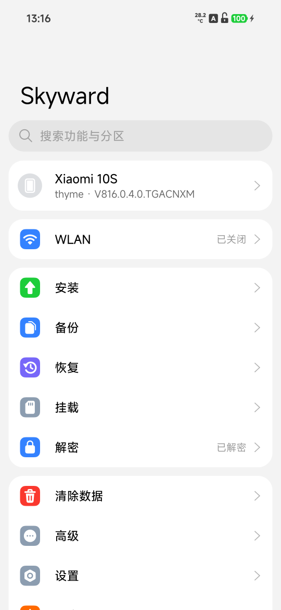
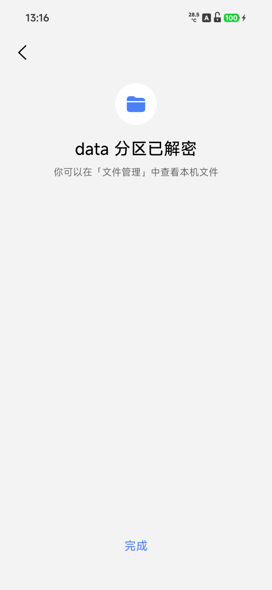
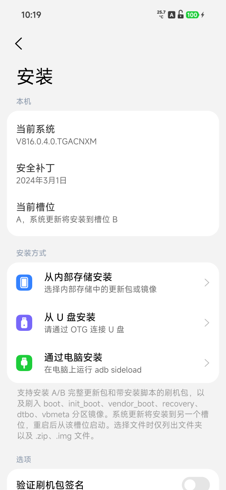
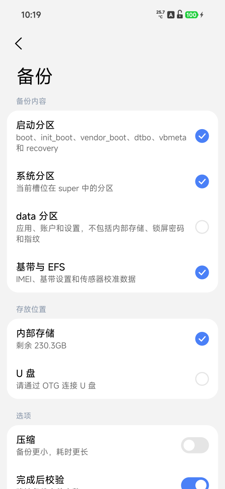
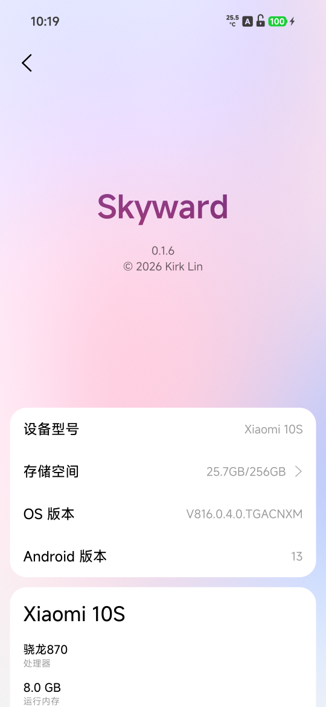

# Skyward

English | [简体中文](README.zh-CN.md)

Skyward is a recovery written in Rust, from scratch.

<p align="center">
  
  
  
  
  
</p>

## Supported devices

> This is a fork of [kirklin/skyward](https://github.com/kirklin/skyward) that adds the Xiaomi 10S
> (`thyme`, Android 13). Upstream supports Android 16 and 17; Android 13 has no AIDL KeyMint of its
> own, so both reaching the key service and letting go of the installed system's partitions differ.

| Device | Codename | Tested system version |
| --- | --- | --- |
| Xiaomi 10S (**this fork**) | `thyme` | OS1.0.4.0.TGACNXM (Android 13) |

The Xiaomi 10S (`thyme`) has no recovery partition of its own: the image goes into the
running slot's boot partition, whose system boot image it replaces.

```sh
unzip skyward-v0.2.0-thyme-OS1.0.4.0.TGACNXM.zip
fastboot flash boot_a skyward-v0.2.0-thyme-OS1.0.4.0.TGACNXM.img
fastboot reboot recovery
adb in Skyward is a root shell that needs no authorization on the phone: anyone
with the phone and a cable can reach its storage while it is in recovery.

Building
Skyward builds with the stable Rust that rust-toolchain.toml names, with its
aarch64-linux-android target, the Android NDK r29 and
cargo-ndk. The recovery service is built for
the phone, and the packer for the computer:

sh

cargo ndk -t arm64-v8a --platform 30 build --release -p skyward
cargo build --release -p skyward-pack
The second system's first program runs before any library is there to load, so it
is built as a static program:

sh

RUSTFLAGS="-C target-feature=+crt-static" cargo ndk -t arm64-v8a --platform 30 build --release -p skyward-system-init --target-dir target/system-init
The packer takes the stock recovery partition out of the build's full update
package on Xiaomi's server, reading only the part of the package the partition is
in, and checks its SHA-256 against the device file:

sh

target/release/skyward-pack stock --config devices/nezha.toml --out target/stock/nezha/recovery.img
Then it builds the image on top of it:

sh

target/release/skyward-pack recovery \
  --stock target/stock/nezha/recovery.img \
  --binary target/aarch64-linux-android/release/skyward \
  --system-init target/system-init/aarch64-linux-android/release/system-init \
  --config devices/nezha.toml \
  --font resources/fonts/MiSansVF.ttf \
  --mono resources/fonts/KirkMono-Regular.ttf \
  --mono-license resources/fonts/KirkMono-OFL.txt \
  --out target/skyward-nezha.img
Tests and lints run on the computer; what runs only on the phone is linted for it:

sh

cargo test --workspace
cargo clippy --workspace --all-targets -- -D warnings
cargo ndk -t arm64-v8a --platform 30 clippy -p skyward -p skyward-install -p skyward-systems -p skyward-system-init -- -D warnings
skyward-preview draws the pages to PNG files on the computer, with no phone:
each page whole, as a long screenshot, in every state it may be in, and screens
at points of touch and motion. --lang picks the language by its region code,
such as en or zh-TW:

sh

cargo run --release -p skyward-preview -- target/preview --lang en
License
GPL-3.0-or-later
