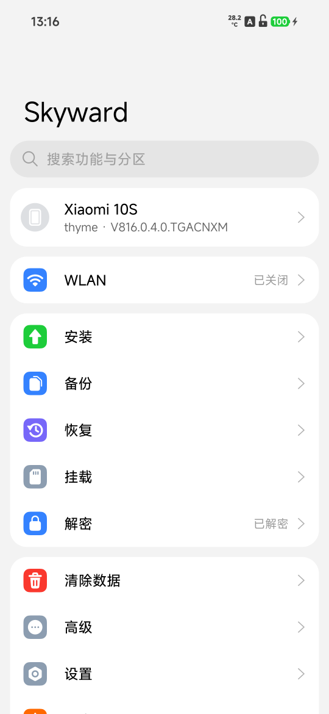
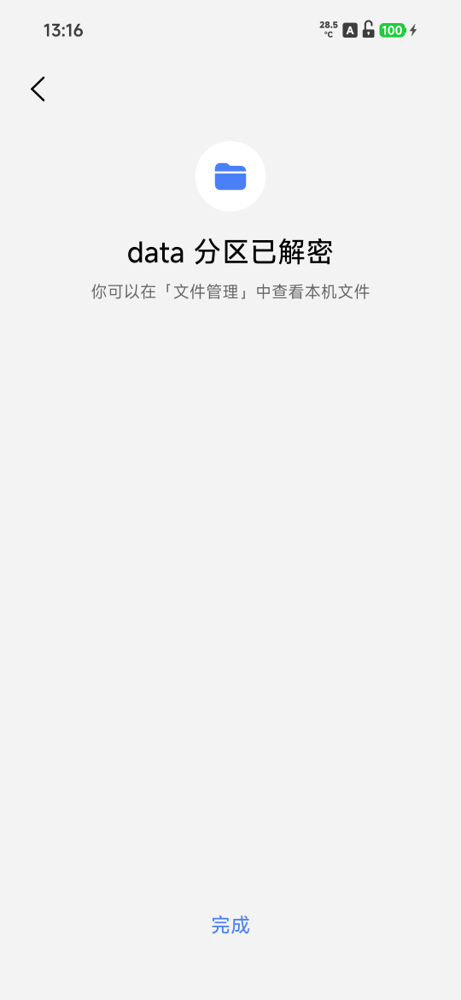
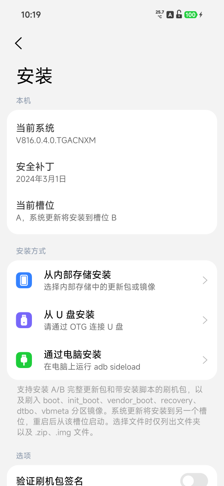
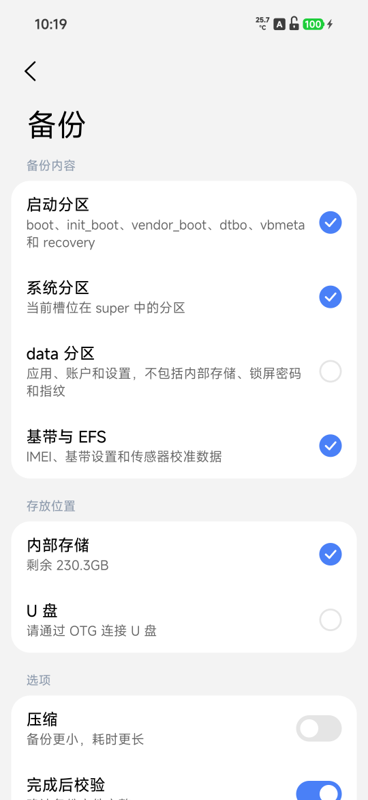
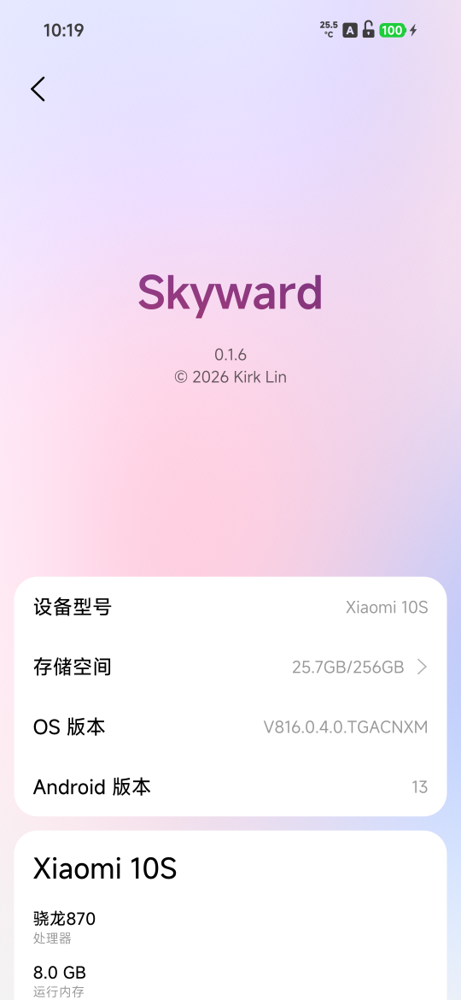

# Skyward

[English](README.md) | 简体中文

Skyward 是使用 Rust 编写的 recovery，从零开始编写。

<p align="center">
  
  
  
  
  
</p>

## 支持的机型

> 本分支是 [kirklin/skyward](https://github.com/kirklin/skyward) 的 fork，新增了小米 10S（`thyme`，Android 13）。
> 上游只支持 Android 16/17，Android 13 没有原生 AIDL KeyMint，取密钥和让出已安装系统分区的做法都不同。

| 机型 | 代号 | 测试的系统版本 |
| --- | --- | --- |
| 小米 10S（**本分支**） | `thyme` | OS1.0.4.0.TGACNXM（Android 13） |

小米 10S（`thyme`）没有独立的 recovery 分区，镜像刷进当前槽位的 boot 分区，那个槽的系统启动镜像会被它取代：

```sh
unzip skyward-v0.2.0-thyme-OS1.0.4.0.TGACNXM.zip
fastboot flash boot_a skyward-v0.2.0-thyme-OS1.0.4.0.TGACNXM.img
fastboot reboot recovery
Skyward 中的 adb 是 root shell，手机上无需授权：手机处于 recovery 的时候，任何人拿到手机和数据线都能访问其中的存储。

构建
Skyward 使用 rust-toolchain.toml 指定的稳定版 Rust 和它的 aarch64-linux-android 目标、Android NDK r29 和 cargo-ndk 构建。recovery 服务针对手机构建，打包工具针对电脑构建：

sh

cargo ndk -t arm64-v8a --platform 30 build --release -p skyward
cargo build --release -p skyward-pack
第二系统启动时运行的第一个程序在任何动态库可用之前运行，因此构建为静态程序：

sh

RUSTFLAGS="-C target-feature=+crt-static" cargo ndk -t arm64-v8a --platform 30 build --release -p skyward-system-init --target-dir target/system-init
打包工具从小米服务器上这个版本的完整更新包中取出原厂 recovery 分区，只读取这个分区所在的部分，并且按照设备配置文件核对 SHA-256：

sh

target/release/skyward-pack stock --config devices/nezha.toml --out target/stock/nezha/recovery.img
然后在它的基础上构建镜像：

sh

target/release/skyward-pack recovery \
  --stock target/stock/nezha/recovery.img \
  --binary target/aarch64-linux-android/release/skyward \
  --system-init target/system-init/aarch64-linux-android/release/system-init \
  --config devices/nezha.toml \
  --font resources/fonts/MiSansVF.ttf \
  --mono resources/fonts/KirkMono-Regular.ttf \
  --mono-license resources/fonts/KirkMono-OFL.txt \
  --out target/skyward-nezha.img
测试和代码检查在电脑上运行；只在手机上运行的代码按照手机目标检查：

sh

cargo test --workspace
cargo clippy --workspace --all-targets -- -D warnings
cargo ndk -t arm64-v8a --platform 30 clippy -p skyward -p skyward-install -p skyward-systems -p skyward-system-init -- -D warnings
skyward-preview 无需手机，在电脑上把页面绘制成 PNG 文件：每个页面完整绘制成长截图的样子，覆盖它可能处于的各种状态，另外还有触摸和动画过程中某些时刻的屏幕。--lang 按照地区代码选择语言，例如 en 或者 zh-TW：

sh

cargo run --release -p skyward-preview -- target/preview --lang en
许可证
GPL-3.0-or-later
